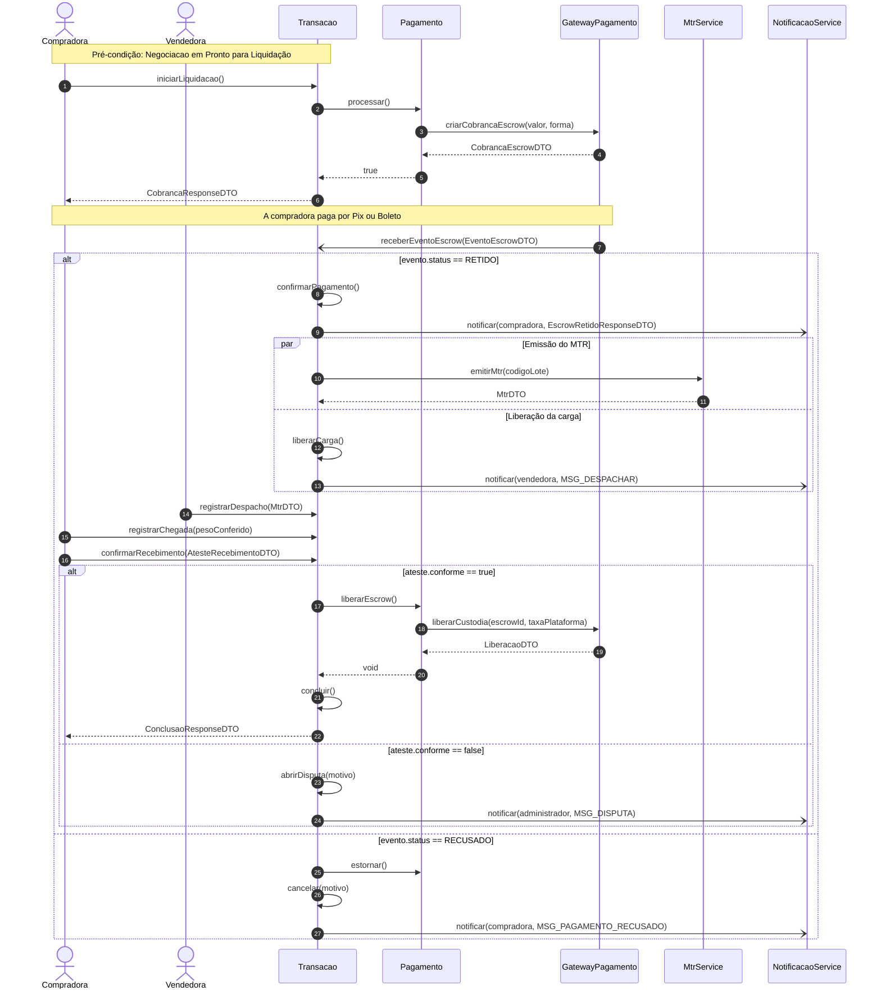
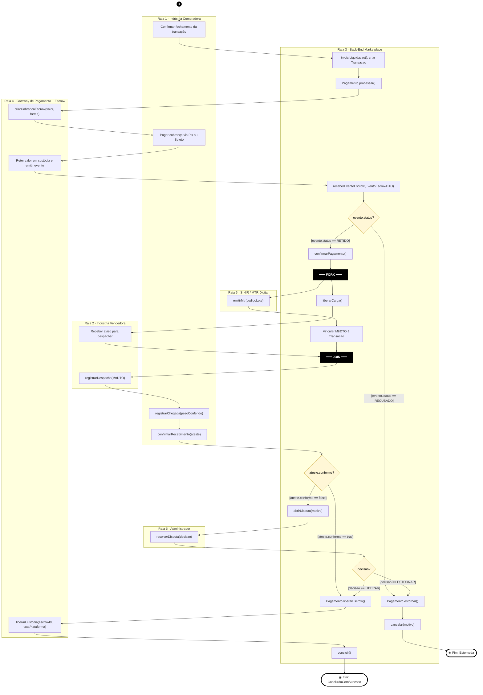
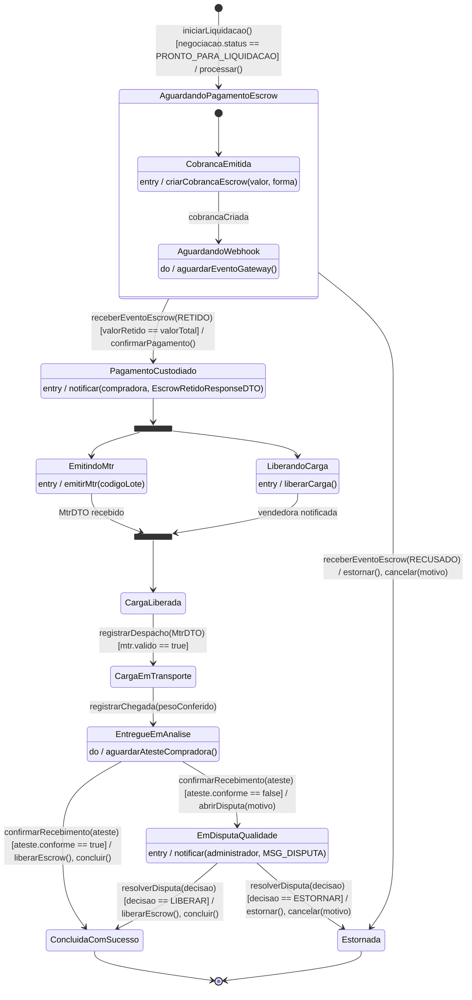
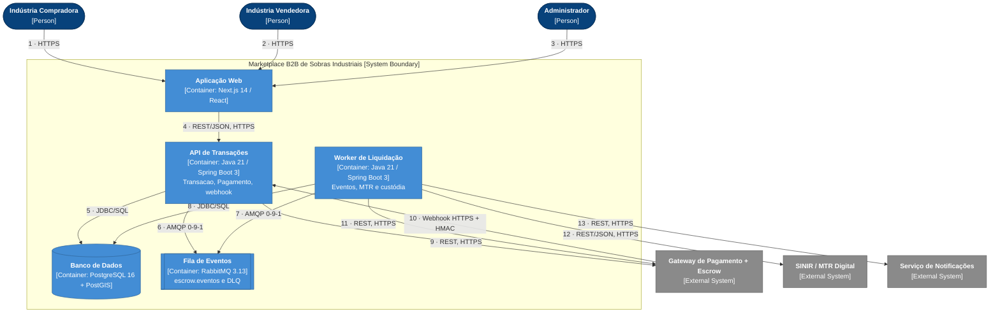

# APS 3 — Dossiê de Arquitetura Viva: Pagamento em Escrow

**Marketplace B2B de Sobras Industriais** (Grupo BTM) · Funcionalidade: *Arremate com retenção de valor em custódia (Escrow)*

| | |
|---|---|
| **Autor** | [Kauan Oliveira Schmidt dos Santos] |
| **Disciplina** | Modelagem de Software, Engenharia de Software (4º período), UniSenai |
| **Docente** | Prof. Sidney L. da Silva |
| **Atividade** | APS 3, individual |

> Todos os diagramas deste repositório são código (Mermaid) versionado junto com o projeto. O C4 também está em C4-PlantUML em [`docs/architecture/workspace.puml`](docs/architecture/workspace.puml).

---

## 1. A funcionalidade

**Componente escolhido:** Pagamento (módulo 5 do Marketplace), cobrindo UC10 *Concluir Transação B2B* e UC11 *Processar Pagamento em Escrow*, com o UC12 *Emitir e Vincular MTR Digital* como parte do fluxo.

**Em uma frase:** quando a negociação chega a "Pronto para Liquidação" (o arremate), o valor da compradora fica retido em custódia no gateway até ela atestar o recebimento do lote. Só então o dinheiro é repassado à vendedora, descontada a taxa da plataforma.

| Item | Descrição |
|---|---|
| **Atores** | Indústria Compradora, Indústria Vendedora, Administrador |
| **Sistemas externos** | Gateway de Pagamento + Escrow, SINIR/MTR Digital, Serviço de Notificações |
| **Entidade principal** | `Transacao` (ciclo de vida em `StatusTransacao`) |
| **Pré-condição** | `Negociacao` em "Pronto para Liquidação"; compradora com saldo/limite aprovado no gateway |
| **Pós-condição (sucesso)** | Valor liberado à vendedora, MTR vinculado, histórico de destinação arquivado, status `ConcluidaComSucesso` |
| **Exceções tratadas** | Pagamento recusado (`Estornada`); divergência no recebimento (`EmDisputaQualidade`, com mediação do Administrador) |

**Fluxo principal:**
1. A compradora confirma o fechamento e o sistema cria a cobrança no gateway (Pix ou Boleto).
2. O gateway avisa por webhook que o valor foi retido em custódia (Escrow).
3. Em paralelo, o sistema emite o MTR no SINIR e libera a carga, notificando a vendedora.
4. A vendedora despacha o lote, vinculando o MTR.
5. A compradora registra a chegada e atesta o recebimento.
6. Se estiver conforme, o Escrow é liberado e a transação é concluída. Se não, abre-se uma disputa.

---

## 2. Contratos: operações públicas e DTOs

Fonte de verdade para a **regra de consistência**: toda mensagem do diagrama de sequência corresponde a uma operação desta tabela. Operações marcadas com ✱ são novas em relação ao diagrama de classes da Sprint 2.

| Classe / Interface | Operação pública | Retorno |
|---|---|---|
| `Transacao` | `iniciarLiquidacao()` ✱ | `CobrancaResponseDTO` |
| | `receberEventoEscrow(evento: EventoEscrowDTO)` ✱ | `void` |
| | `confirmarPagamento()` | `void` |
| | `liberarCarga()` | `void` |
| | `registrarDespacho(mtr: MtrDTO)` ✱ | `void` |
| | `registrarChegada(pesoConferido: BigDecimal)` ✱ | `void` |
| | `confirmarRecebimento(ateste: AtesteRecebimentoDTO)` ✱ | `ConclusaoResponseDTO` |
| | `abrirDisputa(motivo: String)` ✱ | `void` |
| | `resolverDisputa(decisao: DecisaoDisputa)` ✱ | `void` |
| | `concluir()` | `void` |
| | `cancelar(motivo: String)` | `void` |
| `Pagamento` | `processar()` | `Boolean` |
| | `liberarEscrow()` | `void` |
| | `estornar()` | `void` |
| `GatewayPagamento` ✱ (externo) | `criarCobrancaEscrow(valor: BigDecimal, forma: FormaPagamento)` | `CobrancaEscrowDTO` |
| | `liberarCustodia(escrowId: String, taxa: BigDecimal)` | `LiberacaoDTO` |
| `MtrService` ✱ | `emitirMtr(codigoLote: String)` | `MtrDTO` |
| `NotificacaoService` ✱ | `notificar(destinatario, mensagem)` | `void` |

**DTOs:** `CobrancaEscrowDTO` (resposta do gateway), `CobrancaResponseDTO` (resposta à compradora), `EventoEscrowDTO` (status `RETIDO` ou `RECUSADO`, `escrowId`, `eventoId`), `EscrowRetidoResponseDTO` (definido na Sprint 2: `transacaoId`, `codigoLote`, `escrowIdGateway`, `valorRetido`, `taxaPlataforma`, `forma`, `status`, `retidoEm`), `MtrDTO`, `AtesteRecebimentoDTO` (`conforme`, `observacao`), `LiberacaoDTO`, `ConclusaoResponseDTO`. Um *mapper* devolve sempre o DTO, nunca a entidade.

---

## 3. Diagramas

### 3.1 Diagrama de Sequência (`docs/diagrams/sequencia.mmd`)

Setas `->>` são chamadas síncronas bloqueantes e `-)` são chamadas assíncronas (mensageria/webhook). Há dois fragmentos `alt/else` aninhados e um `par` (paralelismo).



### 3.2 Diagrama de Atividades com Raias (`docs/diagrams/atividades.mmd`)

Seis raias (Compradora, Vendedora, Back-End, Gateway, SINIR e Administrador). Barras **FORK** e **JOIN** para a execução paralela, e três decisões com guardas mutuamente exclusivas.



### 3.3 Diagrama de Transição de Estados (`docs/diagrams/estados.mmd`)

Entidade: `Transacao`. Estado inicial, subestados em `AguardandoPagamentoEscrow`, terminais `ConcluidaComSucesso` e `Estornada`, ações internas (`entry /`, `do /`) e transições no formato `Gatilho [Guarda] / Ação()`.



### 3.4 Visão Arquitetural C4, nível 2 (`docs/architecture/c4-containers.mmd`)



| # | Origem → Destino | Finalidade | Protocolo |
|---|---|---|---|
| 1, 2, 3 | Compradora / Vendedora / Administrador → Aplicação Web | Uso da interface | HTTPS |
| 4 | Aplicação Web → API de Transações | `iniciarLiquidacao`, `registrarDespacho`, `registrarChegada`, `confirmarRecebimento` | REST/JSON sobre HTTPS |
| 5 | API → Banco de Dados | Lê e grava `Transacao` e `Pagamento` | JDBC/SQL |
| 6 | API → Fila de Eventos | Publica o `EventoEscrowDTO` | AMQP 0-9-1 |
| 7 | Worker → Fila de Eventos | Consome eventos (com DLQ para falhas) | AMQP 0-9-1 |
| 8 | Worker → Banco de Dados | Atualiza o estado da `Transacao` (idempotente) | JDBC/SQL |
| 9 | API → Gateway | `criarCobrancaEscrow` | REST sobre HTTPS |
| 10 | Gateway → API | Webhook do Escrow, validado por assinatura HMAC | HTTPS |
| 11 | Worker → Gateway | `liberarCustodia` | REST sobre HTTPS |
| 12 | Worker → SINIR | `emitirMtr` | REST/JSON sobre HTTPS |
| 13 | Worker → Serviço de Notificações | `notificar` | REST sobre HTTPS |

A seta assíncrona `G-)T: receberEventoEscrow` da sequência é realizada, na arquitetura, pelos conectores **10, 6 e 7**: webhook, fila e Worker.

### 3.5 Registro de Decisão Arquitetural

[`docs/architecture/adr-0001.md`](docs/architecture/adr-0001.md): **ADR 0001, Confirmação do Escrow por webhook assíncrono com mensageria (RabbitMQ)**.

---

## 4. Consistência entre os modelos (rastreabilidade)

| Etapa | Sequência | Atividades | Estados | C4 |
|---|---|---|---|---|
| Iniciar liquidação | `iniciarLiquidacao()`, `processar()` | Raia Back-End: criar `Transacao` | `[*] → AguardandoPagamentoEscrow` | 4, 5 |
| Criar cobrança | `criarCobrancaEscrow` | Raia Gateway | `CobrancaEmitida` | 9 |
| Pagamento retido | `receberEventoEscrow(RETIDO)`, `confirmarPagamento()` | Decisão `evento.status?` | `PagamentoCustodiado` | 10, 6, 7 |
| MTR e liberação em paralelo | `par ... and ... end` | **FORK / JOIN** | fork/join, `EmitindoMtr` e `LiberandoCarga` | 12, 13 |
| Despacho | `registrarDespacho` | Raia Vendedora | `CargaEmTransporte` | 4 |
| Chegada | `registrarChegada` | Raia Compradora | `EntregueEmAnalise` | 4 |
| Ateste conforme | `confirmarRecebimento` + `liberarEscrow()` | Decisão `ateste.conforme?` = true | `ConcluidaComSucesso` | 11 |
| Ateste divergente | `abrirDisputa` | `abrirDisputa` e raia Administrador | `EmDisputaQualidade` | 13 |
| Pagamento recusado | `receberEventoEscrow(RECUSADO)`, `estornar()`, `cancelar()` | Decisão `evento.status?` = RECUSADO | `Estornada` | 10 |
| Resolver disputa | (fora da sequência) | `resolverDisputa` e decisão `decisao?` | `EmDisputaQualidade → ConcluidaComSucesso ou Estornada` | 4 |

**Proteção da entidade contra estados inválidos:** a `Transacao` só aceita as transições desenhadas no diagrama de estados. Qualquer operação chamada fora do estado previsto é rejeitada sem alterar o estado (por exemplo, `confirmarRecebimento()` com a transação em `AguardandoPagamentoEscrow`). Eventos duplicados do gateway são descartados pela chave de idempotência (`escrowId` + `eventoId`), e `liberarEscrow()` só é alcançável a partir de `EntregueEmAnalise` ou `EmDisputaQualidade`, nunca antes da custódia.

---

## 5. Decisões de modelagem e premissas

- **Arremate:** na Sprint 2 o fechamento do negócio acontece por proposta, contraproposta e aceite eletrônico. Neste dossiê, "arremate" é o momento em que a `Negociacao` chega a "Pronto para Liquidação" e dá origem à `Transacao`.
- **`Transacao` como orquestradora:** as operações de ciclo de vida ficam na `Transacao`, que delega o pagamento à classe `Pagamento` (composição), como no diagrama de classes da Sprint 2.
- **Gateway, MTR e notificações** são interfaces externas. As operações delas foram declaradas na seção 2 para cumprir a regra de consistência.
- **Paralelismo:** a emissão do MTR e a liberação da carga são independentes depois da custódia. Se o pagamento falha, nenhuma das duas acontece (fluxo de exceção FE01 do UC10).
- **Mensagens `MSG_*`** na sequência representam textos de notificação (constantes), sem relevância estrutural.

---

## 6. Como visualizar

- No GitHub, os blocos ` ```mermaid ` deste README são renderizados automaticamente.
- Os arquivos `.mmd` podem ser colados em <https://mermaid.live>.
- O `workspace.puml` (C4-PlantUML) renderiza no [PlantUML Server](https://www.plantuml.com/plantuml) ou na extensão do VS Code.

## 7. Estrutura do repositório

```text
aps3-nome-sobrenome/
├── docs/
│   ├── architecture/
│   │   ├── workspace.puml        # C4 nível 2 em C4-PlantUML
│   │   ├── c4-containers.mmd     # C4 nível 2 em Mermaid
│   │   └── adr-0001.md           # Registro de Decisão Arquitetural
│   └── diagrams/
│       ├── sequencia.mmd
│       ├── atividades.mmd
│       └── estados.mmd
└── README.md
```
